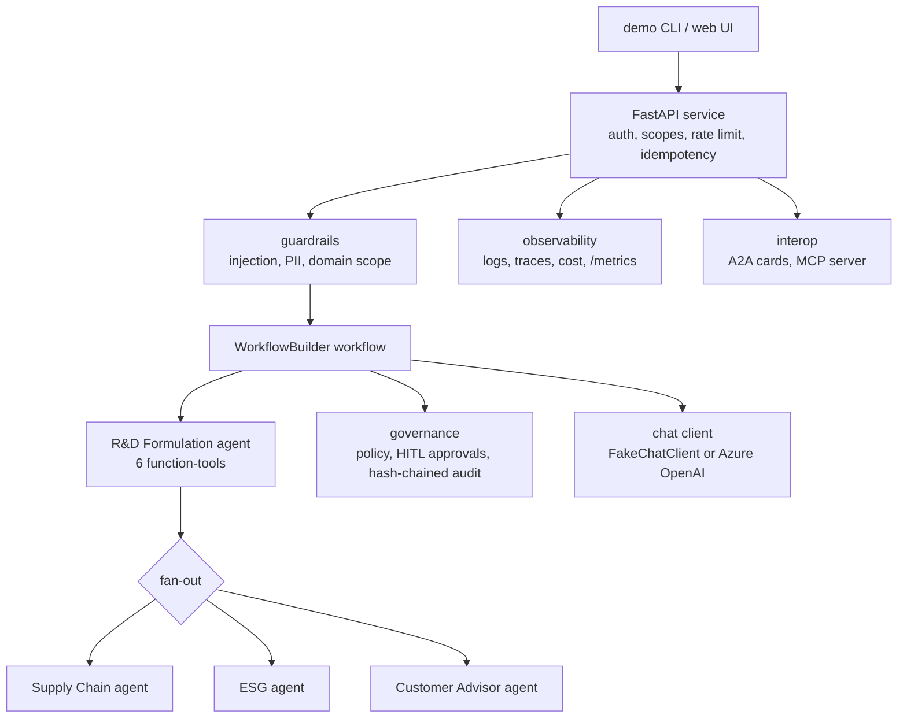

# Jagadish Food-Ingredients Agentic AI (Demo)

[](https://github.com/jagadishmazure-jpg/Jagadish-food-ingredients-agentic-ai/actions/workflows/ci.yml)
[](https://github.com/jagadishmazure-jpg/Jagadish-food-ingredients-agentic-ai/actions/workflows/qa.yml)
[](https://github.com/jagadishmazure-jpg/Jagadish-food-ingredients-agentic-ai/actions/workflows/codeql.yml)


A from-scratch, multi-agent AI system for **clean-label ingredient
manufacturing** — a portfolio-grade reference implementation.

> **Status:** runs offline and in CI only. Nothing is deployed; the Azure
> path in [DEPLOYMENT.md](DEPLOYMENT.md) is documented and validated
> (`terraform validate`), never applied.

> **Disclaimer — read first.** This is an **independent portfolio project**.
> It is **not affiliated with, endorsed by, or connected to any real
> company**. Every ingredient, formula, demand series, ESG reading,
> price, and prediction in this repository is **synthetic demo data invented
> for illustration**. Ingredient names are fictional. Nothing here is food-
> science advice and nothing should be used to formulate real products.

## Recruiter summary

- **What it is:** a multi-agent system on Microsoft Agent Framework 1.0 for a
  fictional food-ingredients manufacturer: four domain agents (R&D
  formulation, supply chain, ESG, customer advisor) behind a FastAPI service,
  with governance, guardrails, evals, A2A/MCP interop and an Azure IaC path.
- **Real numbers:** the headline scenario flags 7 ingredients, substitutes 6,
  removes 1, predicts 92.2% texture match and 8.2 days shelf-life, and rejects
  the "natural" claim; the labelled eval suite passes 20/20; 687 tests pass
  (2 skipped), plus a Playwright API/UI suite in CI.
- **Engineering:** deterministic offline runs with a scripted chat client,
  pinned CI (tests, lint, Terraform validate, gitleaks, Playwright, CodeQL),
  and honest labelling of every heuristic and synthetic number.

## What it does

Four specialist agents, coordinated by a planner/orchestrator, walk through
an end-to-end clean-label reformulation:

| Agent | Capabilities |
|---|---|
| **R&D Formulation** | Flags non-clean-label ingredients · recommends clean-label swaps · predicts texture & shelf-life (demo heuristic) · computes nutrition · validates label claims per region · generates formulation spec + tech sheet |
| **Supply Chain** | Demand forecasting (trend model) · inventory/procurement optimization · capacity- and shelf-life-aware production scheduling · quality anomaly detection |
| **ESG** | Synthetic plant data collection · carbon footprint · water/energy intensity · markdown ESG report with traceable calculations |
| **Customer Advisor** | Ingredient recommendations by category/claims/region · sample formulation generator · claim validation · willingness-to-pay pricing bands · customer technical sheet |

The headline scenario: reformulate a **sweet bakery cake** to clean label —
7 ingredients flagged, 6 substituted, 1 removed, texture match 92.2%,
shelf-life 8.2 days, and an honest claim check where 2 of 3 claims pass
("natural" correctly fails while refined sugar remains).

## Framework

Built on **Microsoft Agent Framework 1.0** (`agent-framework-core==1.0.1`,
`agent-framework-openai==1.0.1`):

- One framework `Agent` per domain (R&D formulation, supply chain, ESG,
  customer advisor), each with role instructions.
- Domain logic exposed as framework **function-tools** (plain annotated
  Python functions in `food_ingredients_ai/framework/tools.py`).
- End-to-end demo runs on a `WorkflowBuilder` workflow: sequential R&D
  tool phase → concurrent fan-out to the three supporting agents
  (`food_ingredients_ai/framework/workflow.py`).
- Chat clients are swappable: a scripted `FakeChatClient` (implements the
  framework's `BaseChatClient` interface) for offline/tests, and the
  framework's unified `OpenAIChatClient` against **Azure OpenAI** for live.

The legacy `food_ingredients_ai/core` modules (planner, tool registry, `FakeLLM`)
remain as the tested deterministic execution substrate the function-tools
call into; all agent construction goes through the framework layer.

## Quickstart

Requires Python 3.12+.

```bash
# with uv (recommended)
uv sync --group dev
uv run python -m food_ingredients_ai.demo            # offline: fake client, deterministic
uv run python -m food_ingredients_ai.demo --live     # live: Azure OpenAI (needs .env)

# or plain pip
python -m venv .venv && source .venv/bin/activate
pip install -e . pytest httpx
python -m food_ingredients_ai.demo
```

For live mode, copy `.env.example` to `.env` and set
`AZURE_OPENAI_ENDPOINT` and `AZURE_OPENAI_CHAT_DEPLOYMENT` (see
[docs/foundry-deployment.md](docs/foundry-deployment.md)). With
`AZURE_OPENAI_API_KEY` unset, `DefaultAzureCredential` is used.

Run the tests:

```bash
uv run pytest -q        # or: python -m pytest -q
```

Fully offline, no network or API keys; the framework agents run against the
scripted `FakeChatClient`. Collected now (687 pass; the 2 skips are checks for
the planned `deploy.yml`):

<!-- run: python scripts/count_tests.py -->
```text
689 tests collected
```
<!-- /run -->

## Deploy

```bash
./scripts/deploy-local.sh    # local demo → http://localhost:8000
./scripts/deploy-azure.sh    # Azure Container Apps (needs your own `az login`)
```

Full runbook (prereqs, costs, troubleshooting, teardown, AKS/Terraform
enterprise path): [DEPLOYMENT.md](DEPLOYMENT.md).

## Deploy on Foundry

The agents are structured for **Azure AI Foundry**: same agents, same
workflow, only the chat client changes. Step-by-step — Foundry project
setup, model deployment, env config, live demo, and hosting options
(Container Apps, Foundry Agent Service) — in
[docs/foundry-deployment.md](docs/foundry-deployment.md).

## Deployment (service → Docker → AKS)

The full deployment track — build everything now, deploy when ready:

| Layer | Location |
|---|---|
| Agent service (FastAPI) + demo web UI | `food_ingredients_ai/service/` |
| Docker image (multi-stage, non-root) | `Dockerfile`, `.dockerignore` |
| Terraform (Azure-first, multi-cloud-ready) | `infra/terraform/` |
| Kubernetes manifests (Kustomize) | `infra/k8s/` |
| CI (tests, lint, Terraform validate, secrets, Playwright, CodeQL) | `.github/workflows/` |
| CD (build → push to ACR → deploy) | planned `deploy.yml`, not in the repo yet |
| Runbook | [docs/deployment-runbook.md](docs/deployment-runbook.md) |
| Reliability strategy | [docs/reliability.md](docs/reliability.md) |
| Azure Agentic AI Stack alignment | [docs/stack-alignment.md](docs/stack-alignment.md) |

```bash
# run the service locally (offline demo, deterministic)
uv run uvicorn food_ingredients_ai.service.app:app --port 8000
# mint a demo bearer token, then open http://localhost:8000/
uv run python -m food_ingredients_ai.service.mint_token \
  --scopes formulation:write,supply:read,esg:read,proposal:read
```

Service endpoints: `GET /api/health`, `GET /api/scenarios`,
`GET /api/agent-cards`, `GET /.well-known/agent.json` (public);
`POST /api/reformulate` and `POST /api/agents/{agent}/run`
(bearer-token auth with per-skill scopes, rate limiting, idempotency
keys). Live-LLM failures degrade gracefully to the offline pipeline
(`degraded: true` + `X-Service-Degraded` header).

## Analytics & monitoring

| Capability | Location |
|---|---|
| Run aggregates + peer benchmarking + proactive flags | `food_ingredients_ai/analytics/`, `GET /api/analytics/summary` (`analytics:read` scope) |
| SVG charts in the demo UI (cost vs peers, shelf-life, claim coverage) | `food_ingredients_ai/service/ui.py` |
| Versioned data layer (registry, schema validation, lineage) | `food_ingredients_ai/datalayer/` |
| LLM cost tracking, budgets, optimization recommendations | `food_ingredients_ai/observability/costs.py` |
| Prometheus `/metrics` + alert rules + Grafana dashboard | `food_ingredients_ai/service/metrics.py`, `infra/monitoring/` |
| Analytics methodology (incl. synthetic-data caveats) | [docs/analytics.md](docs/analytics.md) |
| FinOps (budgets, SKU right-sizing, Azure cost notes) | [docs/finops.md](docs/finops.md) |
| SLIs/SLOs, burn-rate alerting, App Insights KQL | [docs/monitoring.md](docs/monitoring.md) |
| Legacy intelligence layer (wrap-don't-replace, L0→L3) | [docs/legacy-intelligence.md](docs/legacy-intelligence.md) |
| Tool-calling patterns (OpenAPI gen, chains, resilience) | [docs/tool-calling.md](docs/tool-calling.md) |
| Threat model, controls, production checklist | [docs/security.md](docs/security.md) |

Peer benchmarks are computed against deterministic synthetic
distributions and are always labeled as such — they demonstrate the
benchmarking pattern, not real market data.

## Agent catalog

| Agent | Function-tools (framework layer) | Deterministic core |
|---|---|---|
| **R&D Formulation** | `analyze_ingredients` · `suggest_substitutes` · `predict_texture_shelf_life` · `calculate_nutrition` · `validate_claims` · `generate_documentation` | `agents/rd_formulation/`: analyzer (injection-aware), cost-aware substitution, texture/shelf-life predictor + bakery stability advisory, nutrition, claim hierarchy validator, doc generator, 5–7-month cycle-time estimator |
| **Supply Chain** | `forecast_demand` · `optimize_inventory` · `schedule_production` · `detect_quality_anomalies` | `agents/supply_chain/`: trend forecaster, reorder-point inventory (SAP-adapter aware), capacity/shelf-life scheduler, anomaly detection |
| **ESG** | `collect_esg` · `calculate_carbon` · `esg_report` | `agents/esg/`: synthetic plant readings, carbon footprint, water/energy intensity, traceable markdown report |
| **Customer Advisor** | `recommend_ingredients` · `generate_sample_formula` · `validate_customer_claims` · `estimate_pricing` · `generate_tech_sheet` | `agents/customer_advisor/`: claim-filtered recommender, sample formulation, WTP-band pricing (+CRM personalization), tech sheet |

Cross-cutting: **governance** (policy engine, HITL approval gates, hash-chained audit, sanitizer/PII scrubber, scoped-token identity), **observability** (JSON logs, OTel tracing, cost/latency, incident metrics), **evaluation** (20-case accuracy suite + demo regression), **interop** (A2A cards/tasks with auth, MCP server, CRM/SAP adapters), **engineering layers** (RAG, context assembly/budgeting, harness, loops, graph orchestration).

## Demo guide

The 7-step talk track lives in [docs/demo-guide.md](docs/demo-guide.md). The
30-second version:

```bash
uv run python -m food_ingredients_ai.demo
```

**Say:** "Four specialist agents on Microsoft Agent Framework 1.0, one
workflow, fully offline and deterministic. The R&D agent flags 7
non-clean-label ingredients, substitutes 6 cost-aware, predicts texture and
shelf-life with documented heuristics, and *rejects* an invalid 'natural'
claim — agents that can't say no aren't trustworthy. Three agents fan out
concurrently for supply, ESG, and customer pricing. Governance is built in:
policy gates, human approvals, audit trails, scoped inter-agent auth."

Steps 1 to 5 of the offline run, as printed:

<!-- run: python -m food_ingredients_ai.demo | sed -n '9,51p' -->
```text
Scenario: reformulate 'Demo Sweet Bakery Cake (conventional baseline)' to clean label.
Target claims: no artificial ingredients, reduced sugar, natural | Region: NA
Constraints: cost-aware, shelf-life >= 7 days (demo targets).

======================================================================
STEP 1 — Ingredient Analysis Agent
======================================================================
Flagged 7 non-clean-label ingredients:
  - ModifiedCornStarch MCS-10 (6.0%): DEMO non-clean-label ingredient: chemically modified starch.; chemically modified starch is not clean-label
  - HighFructoseCornSyrup HFCS-42 (8.0%): DEMO non-clean-label ingredient.
  - ArtificialVanilla AV-01 (1.5%): DEMO non-clean-label ingredient: artificial flavor.; name contains 'artificial' (synthetic ingredient)
  - TitaniumDioxide TD-99 (0.3%): DEMO non-clean-label ingredient: synthetic whitener.
  - Red40 Color R40 (0.2%): DEMO non-clean-label ingredient: synthetic color.; synthetic color (Red 40)
  - SodiumBenzoate SBZ (0.4%): DEMO non-clean-label ingredient: synthetic preservative.
  - Polysorbate60 P60 (1.0%): DEMO non-clean-label ingredient: synthetic emulsifier.; synthetic emulsifier

======================================================================
STEP 2 — Substitution Agent (demo ingredient DB)
======================================================================
  - ModifiedCornStarch MCS-10 -> PureField Starch PF-200: clean-label thickener (cost index 1.2)
  - HighFructoseCornSyrup HFCS-42 -> FruitSweet Blend FS-40: clean-label sweetener (cost index 1.6)
  - ArtificialVanilla AV-01 -> NaturalVanilla NV-60: clean-label flavor (cost index 2.0)
  - REMOVED TitaniumDioxide TD-99: no clean-label alternative in demo DB; removed
  - Red40 Color R40 -> BeetRoot Color BC-12: clean-label color (cost index 2.0)
  - SodiumBenzoate SBZ -> CulturedDextrose CD-55: clean-label preservative (cost index 1.9)
  - Polysorbate60 P60 -> SunflowerLecithin SL-70: clean-label emulsifier (cost index 1.5)
Substituted: 6, removed: 1.

======================================================================
STEP 3 — Texture & Shelf-Life Prediction Agent (demo heuristic)
======================================================================
  Texture match: 92.2%
  Shelf-life:    8.2 days
  No risk flags — within demo targets.

======================================================================
STEP 4 — Nutrition Agent (synthetic values)
======================================================================
  Sugar: 31.44g -> 20.25g per 100g

======================================================================
STEP 5 — Regulatory & Claim Validation Agent (demo rules)
======================================================================
```
<!-- /run -->

Then show the labelled eval suite and the other scenarios
(`--scenario energy_drink`, `--scenario savory_bakery_crackers`, `cola_soft_drink`,
`flavored_water`, `nutritional_shake`):

<!-- run: python -m food_ingredients_ai.evaluation.runner | tail -3 -->
```text
[PASS] substitution_relevance: 10/10 metrics={'top1_accuracy': 1.0}

Total: 20/20 -> PASS (demo, synthetic data)
```
<!-- /run -->

## Architecture



```text
Demo CLI → Framework workflow (WorkflowBuilder)
             ├── R&D Formulation Agent  (6 function-tools, sequential)
             ├── fan-out ─┬─ Supply Chain Agent   (concurrent)
             │            ├─ ESG Agent            (concurrent)
             │            └─ Customer Advisor Agent (concurrent)
             └── shared blackboard ← tool results (deterministic)
```

Chat client swap: `FakeChatClient` (offline/tests) ↔ `OpenAIChatClient`
against Azure OpenAI (live). See [docs/architecture.md](docs/architecture.md)
for the full diagram, design choices, and a conceptual mapping of each
component to Azure (APIM, Functions, Agent Framework, Fabric, Azure OpenAI).

## Project structure

```text
food_ingredients_ai/
  service/         FastAPI agent service + demo web UI: 8-stage agentic
                   pipeline (intake → intent+guardrails → memory read →
                   RAG grounding → tool execution → response+guardrails →
                   memory write → feedback), session store, bearer auth,
                   rate limiting, idempotency, retry/breaker/fallback
  framework/       Microsoft Agent Framework 1.0 layer:
                   clients (fake + Azure OpenAI), function-tools,
                   4 domain Agents, WorkflowBuilder workflow, demo runner
  core/            Deterministic execution substrate: Agent base,
                   Orchestrator/planner, ToolRegistry, message & task-state
                   types, FakeLLM (kept; all tests pin its behavior)
  agents/
    rd_formulation/  analyzer, substitution, predictor, nutrition,
                     regulatory, documentation, cycle_time
    supply_chain/    forecaster, inventory, scheduler, quality
    esg/             collector, carbon, intensity, report
    customer_advisor/ recommender, formulation, claims, pricing, tech_sheet
  governance/      policy engine, HITL approvals, hash-chained audit,
                   input sanitizer, PII scrubber, secret checks, identity
  observability/   JSON logging, OTel-compatible tracing, cost/latency,
                   incident-style metrics
  evaluation/      datasets, metrics (precision/recall/F1/top-1), runner
  interop/         A2A agent cards + task protocol + scoped-token auth,
                   MCP server (tools/list, tools/call, stdio)
  integrations/   CRM + SAP adapter interfaces with synthetic demo doubles
  rag/             doc ingestion/chunking, hash embeddings (offline) /
                   Azure OpenAI embeddings (live), vector store, retrieval
  context/         prompt assembler (instructions+glossary+RAG+blackboard),
                   context-window budgeting
  harness/         retries/backoff, timeouts, circuit breaker, guardrails,
                   eval hooks
  loops/           reflection loop (draft→critique→revise), HITL gate loop
  graph/           nodes/edges/conditional routing/cycles; graph-based
                   reformulation variant
  datalayer/       versioned dataset registry, schema validation (fail-fast),
                   lineage (version + content hash), FileConnector
                   (Fabric/OneLake/Blob/SQL path documented)
  analytics/       run aggregates, synthetic peer benchmarking, trend
                   helpers, proactive anomaly flags
  legacy/          intelligence layer over traditional systems: bridges
                   (uniform envelope, timeouts, error translation),
                   versioned capability catalog, CDC poller + webhooks,
                   L0→L3 autonomy ladder with promotion criteria
  tools/           deeper tool calling: OpenAPI 3.x tool generation
                   (synthetic LIMS doc), chains + fan-out composition,
                   retries/fallback chains/partial success, JSON-schema
                   sandbox with timeouts
  data/            Synthetic JSON/CSV datasets + loader (all fictional)
  guardrails/      input/output safety: injection + jailbreak detection,
                   PII detection, domain-scope enforcement, claim grounding,
                   confidence thresholds; strictness policies via env
  azure_integration/ Azure integration services (offline fakes + prod swap):
                   CloudEvents lifecycle schemas, Service Bus job queue +
                   topics + DLQ, Event Grid domain fan-out, Event Hubs
                   telemetry batching, Functions triggers (HTTP/SB/timer),
                   Logic Apps callbacks + approval workflow, queue worker
  demo.py          Runnable end-to-end narrative: python -m food_ingredients_ai.demo
                   (--live for Azure OpenAI; --scenario …; --audit-log …)
evals/             Regression expectations for the demo (deterministic)
docs/              Architecture, Foundry deployment, identity, governance,
                   integrations, benefits, demo guide, glossary, SOC +
                   architecture alignment, attachments coverage, usecases,
                   context-engineering, harness, loops, graph, reliability,
                   deployment runbook, stack alignment, analytics, finops,
                   monitoring, azure-integration, microsoft alignment
infra/
  terraform/       Azure IaC: RG, ACR, AKS (zonal, workload identity),
                   Key Vault, App Insights, Foundry account + model
                   deployment, Service Bus, Event Grid, Event Hubs,
                   Function App, Logic App, least-privilege RBAC
  logicapps/       Sample Logic Apps approval workflow definition
                   deployment, least-privilege RBAC
  k8s/             Kustomize manifests: namespace, PDB, anti-affinity,
                   HPA, probes, workload-identity SA, Key Vault CSI
  monitoring/      Prometheus alert rules, Grafana dashboard JSON
Dockerfile         Multi-stage service image (python:3.12-slim, non-root)
tests/             offline pytest suite (+ Playwright API/UI QA in qa/)
```

## Deploy

Local: `./scripts/deploy-local.sh` · Cloud: `./scripts/deploy-azure.sh`
(Container Apps, idempotent) · Enterprise: `infra/terraform/` (AKS) —
runbook: [DEPLOYMENT.md](DEPLOYMENT.md).

## Guardrails

- Bearer tokens with per-skill scopes, rate limiting and idempotency keys on the service.
- Input and output guardrails: injection and jailbreak detection, PII detection, domain-scope enforcement, claim grounding, confidence thresholds.
- Policy engine and human approval gates for consequential steps; hash-chained audit log.
- Claims can fail: the regulatory checker rejects "natural" while refined sugar remains.
- Live-LLM failures degrade to the offline pipeline (`degraded: true`) instead of erroring.
- Least-privilege RBAC, managed identity and Key Vault in the Terraform; no secrets in the repo (gitleaks in CI).

## Limitations

- All data is synthetic. Texture, shelf-life, pricing and cycle-time figures come from documented demo heuristics; the figures behind them (5–7 month timelines, a 10% premium for valued claims) are demo assumptions, not sourced statistics.
- The headline numbers are pinned by deterministic tests; they show the pipeline works, not that the predictions are right.
- Live mode against Azure OpenAI is wired but is not exercised in CI.
- Nothing is deployed. Terraform is validated, never applied; `deploy.yml` is planned.
- Terraform reports one deprecation warning (`enable_rbac_authorization` on Key Vault) to address before the azurerm v5 upgrade.
- The repo is large for a demo; some docs describe mapped concepts rather than running features (see the tables in `docs/stack-alignment.md`).

## Built vs planned

| Capability | Status | Where |
|---|---|---|
| Four domain agents on Agent Framework 1.0, workflow fan-out | Built | `food_ingredients_ai/framework/`, `agents/` |
| FastAPI service, auth, rate limits, web UI | Built | `food_ingredients_ai/service/` |
| Governance, guardrails, audit | Built | `governance/`, `guardrails/` |
| Eval suite (20 labelled cases) | Built | `food_ingredients_ai/evaluation/` |
| A2A cards and tasks, MCP server | Built | `food_ingredients_ai/interop/` |
| RAG, context assembly, harness, loops, graph | Built | matching packages |
| Azure integration fakes (Service Bus, Event Grid, Event Hubs, Functions, Logic Apps) | Built (offline fakes) | `azure_integration/` |
| Playwright API/UI QA | Built, runs in CI | `qa/`, `.github/workflows/qa.yml` |
| Terraform and Kubernetes manifests | Built, validated only | `infra/` |
| Live Azure OpenAI mode | Built, not tested in CI | `framework/clients.py` |
| Deployed environment | Not deployed | [DEPLOYMENT.md](DEPLOYMENT.md) |
| GitHub Actions deploy (`deploy.yml`, OIDC) | Planned | not in the repo |

## Docs for adopters and interviews

- [Implementation guide](docs/implementation-guide.md): how to take this to a real Azure tenant, step by step.
- [Interview points](docs/interview-points.md): the talking points and likely follow-up questions.
- [Architecture](docs/architecture.md), [governance](docs/governance.md), [security](docs/security.md), [benefits](docs/benefits.md), [use cases](docs/usecases.md).

## Related repos

| Repo | Why it relates |
|---|---|
| [Jagadish-multi-agent-orchestration](https://github.com/jagadishmazure-jpg/Jagadish-multi-agent-orchestration) | The orchestration patterns used here, in isolation |
| [Jagadish-event-driven-agents](https://github.com/jagadishmazure-jpg/Jagadish-event-driven-agents) | Same food-manufacturing domain, event-driven instead of request-driven |
| [Jagadish-agent-security-redteam](https://github.com/jagadishmazure-jpg/Jagadish-agent-security-redteam) | Attacks and defences for the guardrails here |
| [Jagadish-llm-evals-observability](https://github.com/jagadishmazure-jpg/Jagadish-llm-evals-observability) | Evals and tracing, in isolation |
| [Jagadish-azure-ai-integration-platform](https://github.com/jagadishmazure-jpg/Jagadish-azure-ai-integration-platform) | Azure integration services in more depth |

## Key design decisions

- **Deterministic**: same inputs → same outputs, always. The regression eval
  pins the demo's headline numbers.
- **Claims can fail**: the regulatory checker rejects invalid claims instead
  of rubber-stamping them.
- **Honest heuristics**: the texture/shelf-life predictor is a documented
  linear demo model, not a food-science model.
- **Safe scheduling**: production is never scheduled earlier than shelf-life
  allows, and daily capacity is never exceeded (infeasible plans raise
  errors instead of silently overloading).

## CI

All actions are pinned to commit SHAs, and nothing deploys.

- `ci.yml`: `test` (ruff, shell syntax, compose check, pytest, documented-output
  drift check), `terraform` (fmt, init without backend, validate), `secrets` (gitleaks, full history).
- `qa.yml`: `playwright` starts the service and runs the API and UI suite in Chromium.
- `codeql.yml`: Python, Actions and JavaScript/TypeScript.
- Dependabot for pip, Actions, npm (`qa/`), Terraform and Docker.

## License

MIT — see [LICENSE](LICENSE).
